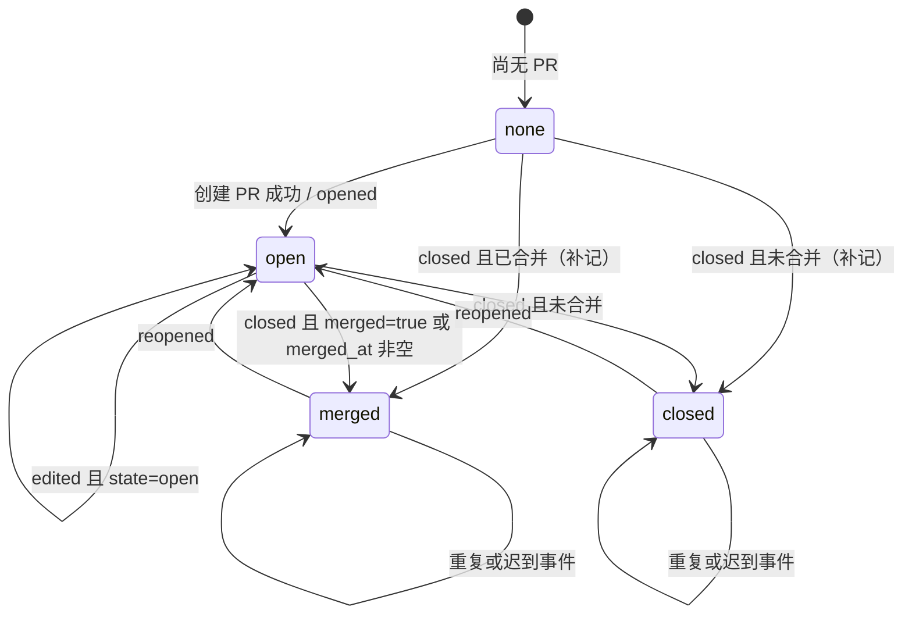

# 同步 GitHub Issue / PR 状态（v0004 / Issue #8）

- 迭代：`v0004`，对应 GitHub Issue `#8`
- 文档路径：`docs/v0004-8/design.md`
- 状态：设计稿
- 基线：基石入口 [`docs/README.md`](../README.md)；完整产品设计 [`docs/architecture/design.md`](../architecture/design.md)
- 性质：相对基石的 **PR 生命周期同步与 Issue 状态对齐增量**。不改写文档 / 生成代码的主状态机与入队条件，只增加「PR 建成之后」的远端状态同步。

## 1. 背景

本系统当前在功能迭代主路径上停在「已建PR」：系统负责创建 PR，合并与评审回到 GitHub 完成。创建成功后只保存 `pr_number` / `pr_url`，`issue.status = pr_opened`，之后不再跟踪 GitHub 上该 PR 是开放、已合并，还是未合并关闭，也不跟踪重新打开。

这带来三类不一致：

1. **详情与列表失真**：操作员在 GitHub 合并或关闭 PR 后，本系统仍显示「已建PR」，无法从页面判断 PR 的真实终态。
2. **摘要口径失真**：公司列表的「未结束 Issue 数」、仓库页的未结束功能迭代摘要若仍把 `pr_opened` 当终点，会把已经合并的迭代继续算作未结束。
3. **Issue 侧回写需要核对**：基石已规定 `issues` Webhook 的 `closed` / `reopened` / `deleted` / `edited` 更新 `github_state` 及正文等，但当前订阅与 Inbox 只处理 `issues` 事件，非 `issues`（含 `pull_request`）直接忽略。需要确认开闭、删除、编辑后是否稳定回写，并明确 PR 生命周期与 Issue 开闭的联动展示。

基石原文把「不处理 Pull Request 事件」列为非目标。本迭代在**仍不由本系统合并 PR、不跑评审闭环、不根据 review 评论再改代码**的前提下，有界放开 `pull_request` 事件，只用于已建 PR 的状态同步。合并前必须先更新基石的「非目标」「Webhook 订阅」「状态机」与 `issue` 表说明。

## 2. 目标

### 2.1 PR 状态回写

1. 订阅并处理 GitHub `pull_request` 事件，至少覆盖 `opened` / `reopened` / `closed` / `edited`。
2. 以 payload 的 `merged` / `merged_at` 区分「合并关闭」与「未合并关闭」，不靠 `closed` action 单一判断。
3. 按本系统已保存的 `pr_number` 匹配对应 Issue；匹配不到时安全忽略，不新建仓库或 Issue。
4. 落库并展示 PR 生命周期，至少区分：
   - **开放**：`open`
   - **已合并**：`merged`
   - **已关闭（未合并）**：`closed`，中文文案统一为「已关闭（未合并）」，不使用「未合并关闭」作为徽章文案。
5. 合并或关闭后，Issue 详情 / 列表 / 摘要不再停在含糊的「已建PR」。
6. Webhook 路径继续遵守基石：验签 → Inbox → 202；请求内不调用 GitHub API；Worker Inbox 循环写回；Delivery 去重与 retry / failed 语义不变。

### 2.2 Issue 状态与 GitHub 对齐

1. 补齐 `issues` 事件回写：`opened` / `edited` / `labeled` / `unlabeled` / `closed` / `reopened` / `deleted` 与基石「动作」表一致；`github_state`、标题、正文、标签、`deleted_at` 及时更新。
2. 关闭后继续藏起流程按钮；重新打开后按当时 `issue.status` 恢复，保留现有语义。
3. GitHub 因合并 PR 自动关闭 Issue 时，`github_state` 必须变为 `closed`；同一业务结果由 `pull_request closed` 与 `issues closed` 两条事件先后到达时，两边都要正确，且互不覆盖错。
4. 列表筛选、详情徽章、公司 / 仓库页计数与新口径一致。

### 2.3 页面口径

- 列表「状态」列在已建 PR 后显示 PR 生命周期，而不是永远显示「已建PR」。
- 详情页分别展示「流程状态」和「PR 状态」，并提供 PR 链接。
- 「未结束」计数不再把已合并、已关闭（未合并）的功能迭代算进去。具体默认口径见 4.9，最终口径列入待确认。

### 2.4 文档同步

- 本迭代结论写入本文件。
- 实现 PR 必须同步修改 `docs/architecture/design.md` 的非目标、Webhook 订阅、状态机、`issue` 数据列、页面计数、异常与测试说明。
- 本次任务只允许写 `docs/v0004-8/design.md`，不直接改基石正文。

## 3. 非目标

- 不在本系统内合并、批准、拒绝或关闭 PR，不代替 GitHub Review。
- 不根据 PR review 评论、CI 失败或 Check Run 自动再生成代码。
- 不处理 Issue / PR 评论、Push、Check Run、Workflow Run 等其它事件。
- 不改变编写文档 / 生成代码主状态机的入队条件；仍要求 Issue `github_state = open` 等现有规则。
- 不新增「从本系统关闭 / 重新打开 GitHub Issue 或 PR」的写回；本迭代只读同步 GitHub → 本系统。
- 不把 PR 的标题、正文、review、文件列表、CI 状态同步进本系统。
- 不为已关闭（未合并）的 PR 自动重新生成代码或自动重开 PR。
- 不改变 Webhook 验签、Inbox 持久化、Delivery 去重、retry / failed 语义。
- 不改变创建 PR 的既有规则：分支 `dev_{number}`、标题 `[#{number}] {title}`、正文含 `Closes #{number}`。

## 4. 方案

### 4.1 关键决策：独立 `pr_state`，保留 `issue.status`

**二选一结论：采用独立字段 `issue.pr_state`，不新增 `pr_merged` / `pr_closed` 流程状态。**

理由：

1. `issue.status` 描述的是**本系统流水线进度**，驱动按钮、入队条件和失败重试。PR 是否合并是 GitHub 上的**远端事实**，不是本系统的下一步动作。
2. 若把 `pr_merged` / `pr_closed` 塞进 `status`，PR 重新打开时状态必须回退到 `pr_opened`，与「稳定终点」和「失败后重试」语义纠缠；已合并后若发生异常，也无法区分「流程失败」还是「远端终态」。
3. 基石已经把 `github_state` 与 `issue.status` 分开。PR 状态与 `github_state` 同属远端事实，用独立字段最一致。
4. 独立字段可以只做**幂等置位**，不触碰任务、按钮和重试逻辑；`issue.status = pr_opened` 继续表示「PR 已成功创建过」。

因此：

- `issue.status` 仍为 `pr_opened` 时，含义是「PR 已创建过」，不因合并 / 关闭 / 重开而改变。
- `issue.codegen_phase` 仍停在 `pr_opened`，不因 PR 合并 / 关闭而回退。
- 页面用 `status + pr_state` 派生展示文案；筛选和计数读 `pr_state`。
- 不新增 `pr_merged` / `pr_closed` 状态值，不改现有状态机图。

### 4.2 数据模型增量

`issue` 表新增列：

| 列 | 类型 | 说明 |
| --- | --- | --- |
| `pr_state` | 枚举文本，非空，默认 `none` | `none`、`open`、`merged`、`closed`。`none` 表示尚无 PR，或历史数据尚未同步 |
| `pr_state_updated_at` | `timestamptz`，可空 | 最近一次应用的 GitHub PR 事件时间，用于乱序保护 |
| `pr_merged_at` | `timestamptz`，可空 | 合并时间，仅 `pr_state = merged` 时有展示意义 |
| `github_state_updated_at` | `timestamptz`，可空 | 最近一次应用的 Issue 开闭 / 删除事件时间，用于乱序保护；不参与「文档完成后有更新」判断 |

约束与索引：

- 新增部分唯一索引：`(repository_id, pr_number)`，条件 `pr_number IS NOT NULL`，保证一个仓库内一个 PR 号只对应一个 Issue。
- 可选索引：`(repository_id, pr_state)`，服务列表筛选和未结束计数。
- 迁移时：
  - 已有行 `pr_state = none`、`pr_state_updated_at = NULL`、`pr_merged_at = NULL`。
  - `github_state_updated_at` 回填为 `github_updated_at`，为空时回填 `updated_at`。
  - 不根据 `pr_number` 猜测 `pr_state`，避免把已经合并的历史 PR 误标为开放。

`pr_state = none` 且 `pr_number` 非空的历史行，页面显示「已建PR（状态未同步）」，并继续计入未结束，直到收到新的 PR 事件或被一次性回填。历史回填见第 7 节待确认。

### 4.3 PR 状态机

字段 `issue.pr_state`。它只由 `pull_request` 事件和创建 PR 的成功响应推进，不驱动任务。



规则：

- `action = opened` / `reopened`：`pr_state = open`，清空 `pr_merged_at`。
- `action = closed`：`merged = true` 或 `merged_at` 非空 → `merged`，写入 `pr_merged_at`；否则 → `closed`，清空 `pr_merged_at`。
- `action = edited`：按 payload 当前的 `state` / `merged` / `merged_at` 重新推导，不假设仍是开放。
- 其它 `pull_request` action：投递标记 `ignored`，不改业务数据。
- 同一状态重复到达：仍写 `pr_state_updated_at`（取较大时间），业务值不变，保持幂等。

### 4.4 Webhook 订阅与入站

GitHub Webhook 订阅事件从「只选 Issues」改为「Issues + Pull requests」。Secret、SSL、Content type、回调路径保持不变。

验签后的入站规则：

| 事件 | 处理 |
| --- | --- |
| `ping` | 验签通过返回 200，不进入 Inbox |
| `issues` | 持久化 queued，返回 202 |
| `pull_request` | 持久化 queued，返回 202 |
| 其它事件（`push`、`issue_comment`、`check_run` 等） | 返回 200，不进入 Inbox |
| 签名缺失或错误 | 401，不持久化、不打日志 |

`pull_request` 的所有 action 都进入 Inbox，但 Inbox 只处理 `opened` / `reopened` / `closed` / `edited`；其它 action 标记 `ignored`，保留投递记录便于排查。这样「非目标事件仍 ignored」在投递页可见。

请求内仍不调用 GitHub API。

### 4.5 Inbox 处理 `pull_request`

`pull_request` 路径**不做**公司与仓库的 API 刷新，不按 payload 名称写库：

1. 用 `payload.repository.id` 查本地 `repository.github_repo_id`。找不到 → `ignored`，原因「仓库未收录」。
2. 读取 `payload.pull_request.number`，在 `repository_id` 下查 `issue.pr_number`。找不到 → `ignored`，原因「未匹配到 Issue」。
3. 若同一 `(repository_id, pr_number)` 命中多行（迁移前脏数据），不猜测，`ignored` 并记录错误，等待人工处理。
4. 校验 `pull_request.base.repo.id` 与 `payload.repository.id` 一致；不一致视为跨仓库 PR，`ignored`。
5. 按 4.3 推导 `pr_state`，按 4.6 做时间守卫后写回。
6. 投递与业务写回同一事务提交为 `succeeded`。

不处理 `pull_request.head.repo` 为 fork 的情况；系统创建的 PR 都在同一仓库。若未来支持 fork，再单独设计。

`pull_request` 路径只写 `pr_state`、`pr_state_updated_at`、`pr_merged_at`、`pr_url`：

- `pr_url` 用 `pull_request.html_url` 刷新，防止仓库改名后旧链接失效。
- 不改 `issue.status`、`codegen_phase`、`deleted_at`、`github_state`。
- 不取消、不创建、不重试任何 Job。

### 4.6 幂等、乱序与重复 Delivery

三层保护：

1. **Delivery 去重**：`webhook_delivery.delivery_id` 仍是主键；相同 Delivery 不重复插入，直接返回已有结果。
2. **PR 事件时间守卫**：取 `pull_request.updated_at` 作为事件时间；缺失时依次回退 `merged_at`、`closed_at`、`created_at`。仅当事件时间 `>= issue.pr_state_updated_at` 时应用，应用后写回该时间。迟到事件不会把 `merged` 改回 `open`。全部时间字段都缺失时视为无时间信息，按到达顺序应用，不因守卫丢事件。
3. **Issue 开闭时间守卫**：取 `issue.updated_at` 作为事件时间，仅当 `>= issue.github_state_updated_at` 时应用 `github_state` / `deleted_at`，应用后写回。内容字段（标题、正文、标签）继续用 `github_updated_at` 做类似单调保护。时间缺失时同样按到达顺序应用。

`pull_request` 与 `issues` 事件写同一行的不同列：PR 路径只写 `pr_*`，Issue 路径只写 `github_*` / 正文 / 标签 / `deleted_at`，不整行覆盖，因此「先 PR 后 Issue」和「先 Issue 后 PR」都成立。

### 4.7 创建 PR 时的初始状态

创建 PR 或沿用已有开放 PR 成功后，在同一事务写入 `pr_number`、`pr_url`、`codegen_phase = pr_opened`、`issue.status = pr_opened`，并：

- 若 API 响应中 `state = open` → `pr_state = open`，`pr_state_updated_at` 取响应 `updated_at`，`pr_merged_at = NULL`。
- 若响应已是 `merged` / `closed`（极端快速合并或沿用已有 PR）→ 按 4.3 直接落终态。
- 响应缺少状态字段时保守写 `pr_state = open`，等待后续 `pull_request` 事件纠正。

这样即使 `pull_request opened` 事件在 `pr_number` 落库前到达并被忽略，创建成功也会写入开放态；后续 `closed` 事件仍能匹配并纠正。

### 4.8 Inbox 处理 `issues` 补齐

保留基石动作表，并补充时间守卫与状态对账：

| action | 写入 |
| --- | --- |
| `opened` | 插入或按编号更新；标题、正文、链接、作者、标签、`github_state`、`github_updated_at`、`github_state_updated_at` |
| `edited` | 标题、正文、链接、标签、`github_updated_at`；同时按 `issue.state` 对账 `github_state` |
| `labeled` / `unlabeled` | `label_names`；类型仍可改时按 D2 重算 `kind` / `status`；同时按 `issue.state` 对账 `github_state` |
| `closed` | `github_state = closed`、`github_state_updated_at`；同事务把该 Issue 的 queued Job 改为 `cancelled` |
| `reopened` | `github_state = open`、`github_state_updated_at`；不自动恢复 cancelled Job |
| `deleted` | `deleted_at = issue.updated_at`、`github_state_updated_at`；保留 `status` 与 `github_state`，列表默认不显示 |
| 其它 | `ignored` |

要点：

- `closed` / `reopened` 不更新 `github_updated_at`，避免把「GitHub 开闭」误报成「文档完成后正文有更新」。
- `deleted_at` 一旦写入即视为终态，后续 `issues` 事件不再把 Issue 重新显示出来；如 GitHub 侧确实恢复了已删除 Issue，按人工处理。
- 关闭时不修改 `pr_state`；已合并 PR 与 Issue 自动关闭是两条独立事实。
- running Job 不因 Issue 关闭而终止，仍按基石跑完并写回状态。
- 重复 `closed` / `reopened` 到达时，守卫与幂等写入保证结果不变。

### 4.9 页面展示、筛选与计数

#### 展示文案

列表「状态」列和详情页主徽章使用派生文案：

| 条件 | 文案 |
| --- | --- |
| `status = pr_opened` 且 `pr_state = open` | 已建PR |
| `status = pr_opened` 且 `pr_state = merged` | 已合并 |
| `status = pr_opened` 且 `pr_state = closed` | 已关闭（未合并） |
| `status = pr_opened` 且 `pr_state = none` 且 `pr_number` 非空 | 已建PR（状态未同步） |
| 其它 | 沿用现有流程状态文案 |

详情页摘要条分别展示：

- 流程状态：仍显示 `已建PR`，说明这是本系统流水线状态。
- PR 状态：`开放` / `已合并` / `已关闭（未合并）` / `状态未同步` / `无 PR`。
- 合并时显示「合并于 YYYY-MM-DD HH:mm」；未合并关闭不显示合并时间。
- PR 链接始终保留，合并 / 关闭后仍可打开。

徽章遵循界面契约：文字 + 颜色，不只靠颜色；「已合并」用成功色，「已关闭（未合并）」用中性或警告色，「开放」用信息色。

#### 筛选

Issue 列表新增查询参数 `pr_state`，写入 URL：

| 值 | 含义 |
| --- | --- |
| 空 / `all` | 不按 PR 状态筛选 |
| `none` | 无 PR 或状态未同步 |
| `open` | PR 开放 |
| `merged` | PR 已合并 |
| `closed` | PR 已关闭（未合并） |

现有 `kind`、`status`、`github_state`（默认 `open`）筛选保持不变；切换任一筛选重置 `page = 1`。从详情返回列表时保留原 query。

#### 计数

- 公司列表「未结束 Issue 数」默认口径改为：

  ```text
  deleted_at IS NULL
  AND github_state = 'open'
  AND (
        (kind = 'feature' AND pr_state NOT IN ('merged', 'closed'))
        OR (kind = 'support' AND status = 'support_open')
      )
  ```

  即：功能迭代只要 PR 还没到「已合并」或「已关闭（未合并）」就算未结束；人工介入仍按待处理计。`pr_state = none` 且 `pr_number` 非空的历史行按「状态未同步」计入，避免漏报。

- 仓库列表「开放 Issue 数」保持「GitHub `github_state = open` 且未删除」的定义，不按 PR 状态过滤；如实现中存在「未结束功能迭代」摘要，使用上面的未结束口径。
- 详情页跳转链接仍带原筛选条件；合并 / 关闭后的 Issue 默认仍在 `github_state = open` 列表中可见（未合并关闭通常 Issue 仍开放），直到 GitHub 关闭它。

### 4.10 与主流程、按钮和任务的关系

- `pull_request` 事件不改变 `issue.status`，因此不触发、不取消、不重试任何 Job。
- 已合并 / 已关闭（未合并）后，列表和详情不提供服务端写操作，只保留「查看 PR」外链。
- Issue 关闭后仍藏起流程按钮；重新打开后按当时 `issue.status` 恢复。已合并 PR 的 Issue 被重新打开时，`pr_state` 仍为 `merged`，不会自动生成新代码。
- 已关闭（未合并）后是否允许重新生成代码或重开 PR，本期不做，见第 7 节待确认。
- 创建 PR 失败的既有重试路径不变：`status = generated`、`failed_action = create_pr` 时仍可「重试创建 PR」；成功后写 `pr_state = open`。

## 5. 影响面

| 区域 | 影响 |
| --- | --- |
| `app/api/v1/webhook.py` | 事件门从仅 `issues` 扩展为 `issues` + `pull_request`；其它事件仍 200 不入 Inbox；验签与 202 语义不变 |
| `app/services/ingest.py` | 按事件分派；`pull_request` 走本地匹配与 `pr_state` 写回，不调用 GitHub API；`issues` 补齐状态守卫与 `closed` 取消 queued |
| 新增 `app/services/pr_sync.py`（建议） | 集中实现 PR 状态推导、匹配、时间守卫和错误原因；便于单测 |
| `app/models/issue.py` | 新增 `pr_state`、`pr_state_updated_at`、`pr_merged_at`、`github_state_updated_at` 及唯一索引 |
| Alembic 迁移 | 新增列、部分唯一索引、可选取值约束与回填；不删除旧列、不改旧数据语义 |
| `app/services/github_api.py` | 创建 / 沿用 PR 后返回并写入初始 `pr_state`；仍只使用现有 PR 创建与查询接口 |
| `app/crud/issue.py` | 增加 PR 状态更新、按 `pr_number` 匹配、未结束计数查询 |
| `app/api/v1/issues.py` | 列表增加 `pr_state` 筛选；详情增加 PR 状态、合并时间和派生徽章上下文；计数改用新口径 |
| `app/api/v1/companies.py` | 公司列表未结束计数改用新口径 |
| `app/templates/issues.html` | 状态列派生文案、`pr_state` 筛选控件、URL 参数保留 |
| `app/templates/issue_detail.html` | 摘要条增加 PR 状态与合并时间；不新增写操作 |
| `app/templates/companies.html` | 未结束计数文案与口径同步 |
| `tests/test_webhook.py` | 增加 `pull_request` 202、非订阅事件 200 不入 Inbox、签名失败 401 |
| `tests/test_sync.py` / 新增 `tests/test_pr_sync.py` | 覆盖 merged / closed / reopened / edited、匹配失败 ignored、重复与乱序 |
| `tests/test_issues.py` | 覆盖 Issue closed / reopened / deleted / edited 的时间守卫、queued 取消与列表可见性 |
| `tests/test_issues.py` / `tests/test_ui.py` | 覆盖列表徽章、`pr_state` 筛选、详情 PR 状态、未结束计数 |
| 文档 | 实现 PR 更新 `docs/architecture/design.md` 的非目标、Webhook 订阅、状态机、`issue` 表、页面计数、异常与测试；更新部署文档中的 Webhook 勾选步骤 |
| 配置 / 运维 | GitHub Webhook 手工勾选 `Pull requests`；GitHub App 或 PAT 需具备读取 PR 的权限。Secret、验签、Inbox 配置不变 |
| 安全 | 新增入站事件仍先验签；payload 只读取白名单字段；PR 路径不调用 GitHub API、不写公司 / 仓库名称；日志不打印 payload |
| 兼容性 | 历史 `pr_opened` 行显示「状态未同步」，不猜测终态；新事件到达后自动纠正；无 PR 的事件仍 ignored |
| 性能 | 每条 PR 投递只做两次本地索引查询和一次更新；不增加外部 API 调用；列表计数增加 `pr_state` 条件，按索引可接受 |

实现时建议覆盖的测试：

- `pull_request opened`：匹配 `pr_number`，`pr_state = open`。
- `pull_request closed` 且 `merged = true` / `merged_at` 非空：`merged`，写 `pr_merged_at`。
- `pull_request closed` 且未合并：`closed`，不写 `pr_merged_at`。
- `pull_request reopened`：回到 `open`，清空 `pr_merged_at`。
- `pull_request edited`：按当前 state 纠正；迟到事件不覆盖新状态。
- 仓库未收录、`pr_number` 无匹配、跨仓库 base：`ignored` 且不写业务数据。
- `issues closed` 与 `pull_request closed` 任意先后到达：`github_state = closed` 且 `pr_state = merged` 同时成立。
- 重复 Delivery、重复 action、乱序 action：最终状态正确且不重复写业务。
- Issue `closed` 取消 queued Job；`reopened` 不恢复 cancelled；`deleted` 默认列表不可见；关闭后无流程按钮。
- 非订阅事件（如 `push`）仍 200 不入 Inbox；未知 `issues` / `pull_request` action 标记 `ignored`。
- 页面：合并 / 关闭徽章可区分；`pr_state` 筛选生效；公司未结束计数排除 merged / closed。

## 6. 验收

- [ ] GitHub 上合并本系统创建的 PR 后，无需手工改库，本系统该 Issue 显示「已合并」，且不再计入「未结束功能迭代」。
- [ ] GitHub 上未合并关闭该 PR 后，本系统显示「已关闭（未合并）」，与「已合并」可区分。
- [ ] PR 重新打开后，本系统回到「开放」态，列表与筛选正确。
- [ ] GitHub 关闭 / 重新打开 / 删除 Issue 后，本系统 `github_state` / `deleted_at` 与列表默认可见性符合基石；关闭后无流程按钮。
- [ ] 仅 `issues`、仅 `pull_request`、两者先后到达，结果幂等正确；重复 Delivery 不重复写坏状态；迟到事件不覆盖新状态。
- [ ] `pr_number` 匹配失败、仓库未收录、跨仓库 PR 均安全忽略，不新建 Issue / 仓库，不写坏数据。
- [ ] 非目标事件仍 ignored 或 200 不入 Inbox；验签失败仍 401；Inbox retry / failed 行为不变。
- [ ] 列表「状态」列、详情「流程状态 / PR 状态」、`pr_state` 筛选、公司未结束计数、仓库摘要口径全部一致。
- [ ] 有自动化测试覆盖：PR merged / closed / reopened、Issue closed / reopened / deleted、匹配失败安全忽略、重复与乱序。
- [ ] 迭代设计写入 `docs/v0004-8/design.md`；实现 PR 同步更新基石的非目标、Webhook、状态机、`issue` 数据列与页面计数；实现走 `dev_8` 并开 PR。
- [ ] 迁移后历史 `pr_opened` 行可正常展示为「状态未同步」，不被误标为开放或已合并。

## 7. 待确认

以下事项 Issue 未给出唯一结论。本文先给出默认处理，最终以评审或实现 PR 确认为准：

1. **（已按目标 A.4 写死，供复核）PR 状态承载方式**：本文选择独立 `pr_state` 字段 + 展示层映射，不新增 `issue.status = pr_merged / pr_closed`。若评审推翻，需要同步调整按钮条件、状态机图、列表筛选和未结束计数，改动面明显更大。
2. **「未结束」最终口径**：本文默认「功能迭代且 `pr_state` 不是 `merged` 或 `closed`」都算未结束，即已关闭（未合并）也视为结束。若严格按 Issue 字面「PR 未合并」，则未合并关闭仍应计入，需要明确；两者只差 `pr_state = closed` 这一项。
3. **历史 Issue 是否按 head 分支反查 PR**：本文默认只按已保存的 `pr_number` 匹配；`pr_number` 为空的历史 Issue 不做 `dev_{n}` / 旧 `issue/{n}` 反查，匹配失败即 ignored。若要对历史数据启用反查，需限定：仅同仓库、仅 `base` 为默认分支、仅唯一命中且该 Issue `pr_number` 为空，并决定是否顺带写 `status = pr_opened`。
4. **历史 `pr_opened` 数据回填**：默认不根据 `pr_number` 猜测状态，页面显示「状态未同步」；可在后续增加一次性只读对账（Worker 任务或运维脚本）查询 GitHub PR 状态。是否本期做、由谁触发、是否需要页面按钮，待确认。
5. **Webhook 配置文档**：GitHub 上需手工勾选 `Pull requests`。建议在 README / 部署文档增加一步说明和截图或检查清单；是否在本迭代实现 PR 中一并补齐，待确认。
6. **已关闭（未合并）后的操作**：本期不提供重新生成代码、重开 PR 或再次创建 PR 的入口。若操作员希望在同一分支重新开 PR，需要另开迭代设计，并明确是否复用 `pr_number`、旧分支和旧提交。
7. **已合并 PR 被重新打开**：本文按 `reopened` 回到 `open` 并清空 `pr_merged_at`。GitHub 上该场景较少见，若评审希望保留合并历史，可改为保留 `pr_merged_at` 只在 `pr_state = merged` 时展示。
8. **GitHub 权限细节**：GitHub App 或 PAT 需要读取 PR。现有 Token 已具备 Pull requests 写权限，理论上满足读取；若使用只读 PAT 或权限收紧，需要补充 `pull_request` 读取权限说明。Webhook 订阅与权限变更均属运维步骤，不在代码内自动完成。
