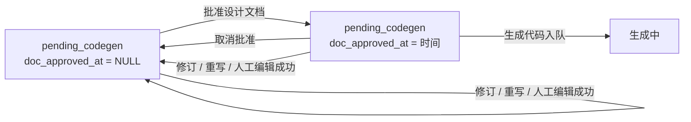

# 设计文档人工审阅与批准门禁（v0009 / Issue #18）

- 迭代：`v0009`，对应 GitHub Issue `#18`
- 文档路径：`docs/v0009-18/design.md`
- 状态：设计稿
- 基线：基石入口 [`docs/README.md`](../README.md)；完整产品设计 [`docs/architecture/design.md`](../architecture/design.md)
- 性质：**工作流门禁 + 数据模型增量 + Issue 详情交互**。不新增流程状态名，不改写文档 / 生成代码的 git、提交、推送与 PR 边界。

## 1. 背景

### 1.1 当前流程的缺口

当前功能迭代路径是「编写文档 → 待生成 → 生成代码 → 已建PR」。一次「编写文档」成功后，`issue.status` 直接变为 `pending_codegen`，详情页的下一步几乎只剩：

- 重新编写文档（整份覆盖）；
- 生成代码。

在「文档已出、代码未动」之间缺少一个明确的人机协商阶段：

1. 操作员不能只针对某几条意见请代理改同一份文档，只能整单重写或直接生成代码；
2. 代理在文档里写下的「待确认 / 问题」没有被结构化展示，无法逐条确认或驳回；
3. 没有「人已审阅并同意这份文档」的显式记录，生成代码无法证明前置共识；
4. 文档只能看，不能在库内做小幅人工修订；
5. 人提了意见、代理改了什么、谁批准了哪一版，没有可追溯记录。

### 1.2 当前实现核对

以本仓库现有代码为准：

| 位置 | 现状 | 与本迭代的关系 |
| --- | --- | --- |
| `app/models/issue.py` | `issue` 有 `design_doc_text`、`design_doc_path`、`iteration_no`、`design_source_updated_at`，没有批准字段 | 需新增可空 `doc_approved_at` |
| `app/services/actions.py` | `actions_for` 对 `pending_codegen` 直接给出「生成代码」和「重新编写文档」 | 需按批准状态分流；未批准不出现可点的生成代码 |
| `app/api/v1/issues.py` | `enqueue_job` 只按 `status` 判断能否生成代码，没有批准校验 | 需增加服务端门禁 |
| `app/tasks/jobs.py` | `run_write_doc` 成功后写 `design_doc_text` 并改 `pending_codegen`，未处理批准 | 成功时清空批准；新增修订任务 |
| `app/services/prompts.py` | 只有 `write_doc_prompt` 与 `codegen_prompt` | 需增加「按意见修订」提示词 |
| `app/templates/issue_detail.html` | 设计文档区只渲染全文；没有编辑、意见、待确认列表、批准入口 | 需新增审阅与批准区 |
| `app/services/markdown_render.py` | 设计文档已经走服务端 Markdown 渲染 + nh3 白名单消毒 | 人工编辑后的渲染复用它，不另建渲染链 |
| `app/models/job.py` | `action` 是字符串列，不是数据库枚举 | 增加 `revise_doc` 不需要改列类型 |
| `app/services/issue_sync.py`、`app/services/ingest.py` | Issue 元数据同步不触碰 `design_doc_*` | 需确认同步也不会清掉 `doc_approved_at` |
| `app/templates/issues.html`、`app/templates/macros/ui.html` | 状态列只显示流程状态 | 需在「待生成」上区分「未批准 / 已批准」 |

### 1.3 问题归纳

本迭代要补的是**文档与代码之间的共识门禁**，不是新增流程状态。批准是一种可撤销的人工确认，必须绑定当前文档正文；任何重新生成正文的路径都要让旧批准失效。

## 2. 目标

### 2.1 批准门禁

- 新增可空字段 `issue.doc_approved_at`；有值表示当前设计文档已被人工批准，`NULL` 表示未批准。
- 首次「编写文档」成功：状态仍为 `pending_codegen`，`doc_approved_at` 为 `NULL`。
- 仅当 `status = pending_codegen` 且 `doc_approved_at` 非空时，才允许从「待生成」进入生成代码；未批准时列表和详情都不出现可点的「生成代码」，直接 POST 也被拒绝。
- 提供「批准设计文档」：写入当前 UTC 时间；提供「取消批准」：清空该字段。
- 代理修订成功写回正文、「重新编写文档」成功、人直接编辑并保存成功，三者都必须清空 `doc_approved_at`。
- Issue 相对 `design_source_updated_at` 又更新时，保留现有 stale 警告；本迭代不因 Issue 更新自动清批准，只提示。
- 列表 / 详情在 `pending_codegen` 上明确显示「未批准 / 已批准」，避免误点生成。

### 2.2 反馈与代理修订

- 新增 `design_feedback` 表，记录人工意见、修订请求、待确认项决定、人工编辑与批准审计。
- 详情页提供意见输入：
  - 「保存意见」：只写 feedback，不调用代理；
  - 「请代理修订」：写 feedback 并在同一事务内入队 `revise_doc` 任务。
- 修订任务沿用同一 `design_doc_path` / `iteration_no`，覆盖库内 `design_doc_text`；成功后清空 `doc_approved_at`。
- 保留「重新编写文档」作为整份重写入口；成功后同样取消批准。
- 修订失败不丢意见，人工可重试；修订单次成功后可把本次纳入的意见标记为「已处理」。

### 2.3 结构化「待确认」

- 从 `design_doc_text` 的「待确认」小节解析标题或列表项，详情页展示可操作列表。
- 每项支持「确认采纳」和「驳回并留言」，决定与文档版本绑定。
- 存在未处理的结构化项时禁止批准；没有可解析项或解析失败时，必须显式勾选「已通读待确认」后才能批准。
- 解析失败降级为「无法结构化，需人工通读」，不阻断人工阅读与编辑。

### 2.4 人直接编辑文档

- 详情页设计文档区提供编辑入口，编辑对象是库内 `design_doc_text`，不是 Git 默认分支文件。
- 保存走 POST + CSRF，成功写库并重新渲染；清空 `doc_approved_at`；写一条 `design_feedback` 审计。
- 仍按现有 Markdown 消毒规则渲染；有进行中的编写 / 修订任务时拒绝保存。
- 不做协同编辑，后写覆盖。

### 2.5 历史数据与基石

- Alembic 新增 `doc_approved_at`，对已有 `status = pending_codegen` 且 `design_doc_text` 非空的行回填批准时间，迁移后仍可直接生成代码。
- 本迭代之后新产生的「刚写完文档」行不回填，保持未批准。
- 实现 PR 同步更新基石 `docs/architecture/design.md` 的状态机、数据模型、页面与测试章节；`docs/README.md` 的系统要点补一条批准门禁摘要。

## 3. 非目标

- 不新增流程状态名；继续使用 `pending_codegen`，批准是字段而不是状态。
- 不做多人会签、角色权限分级、审批人指定、外部客户门户。
- 不做实时协同编辑、冲突合并、版本树或 diff 对比。
- 不根据 PR review 再改代码；本迭代只做人机对设计文档的审阅与批准。
- 不改变系统执行 git、提交、推送、创建 PR 的边界；代理仍不执行这些操作。
- 不把 feedback 同步成 GitHub Issue 评论，也不处理 GitHub 评论 Webhook。
- 不做邮件 / IM 通知、待办提醒、SLA。
- 不在本迭代重做 Issue 详情整体布局、日志轮询或 Markdown 渲染器。
- 不自动判断代理是否真正理解了意见；只要求修订任务成功写回，最终是否同意仍由人批准。
- 不改变 `design_doc_path`、`iteration_no` 的分配规则；修订和人工编辑不重新分配序号。

## 4. 方案

### 4.1 总体状态与批准语义

不新增状态。`pending_codegen` 仍是「文档已入库、代码未生成」的唯一状态；`doc_approved_at` 只控制该状态下的生成代码门禁。



说明：

- 批准不改变 `issue.status`，只写 `doc_approved_at`。
- 「修订 / 重写 / 人工编辑成功」都会写入新正文，因此旧批准必须失效；失败不覆盖正文，也不清旧批准。
- `pending_codegen` 下的「生成代码」严格按 `doc_approved_at` 判断；`failed` 的重试入口默认也要求非空，见 4.3 与「待确认」。
- 现有 stale 警告逻辑不变：`github_updated_at > design_source_updated_at` 时提示「Issue 在文档完成后有更新」。本迭代不自动清批准，避免把「Issue 有更新」误当成「文档已审阅」。

事件与字段变化：

| 事件 | `status` | `doc_approved_at` | `design_doc_text` | 说明 |
| --- | --- | --- | --- | --- |
| 首次编写文档成功 | `pending_codegen` | `NULL` | 新正文 | 新文档必须重新审阅 |
| 重新编写文档成功 | `pending_codegen` | `NULL` | 整份覆盖 | 路径与迭代号不变 |
| 代理修订成功 | `pending_codegen` | `NULL` | 同路径覆盖 | 意见纳入后重新审阅 |
| 人直接编辑保存成功 | `pending_codegen` | `NULL` | 人工覆盖 | 写审计 feedback |
| 批准 | 不变 | 当前 UTC 时间 | 不变 | 不改状态 |
| 取消批准 | 不变 | `NULL` | 不变 | 不改正文 |
| 生成代码入队 | 不变 | 不变 | 不变 | Worker 领取后才改 `generating` |
| Issue Webhook / 手动同步更新 | 不变 | 不变 | 不变 | 仅可能触发 stale 警告 |
| 生成代码失败 | `failed` | 保留 | 不变 | 修文档前批准仍在，但生成入口被失败状态挡住 |
| 创建 PR / 已建PR | 不变 | 保留 | 不变 | 本迭代不再使用批准门禁 |

### 4.2 数据模型

#### 4.2.1 `issue.doc_approved_at`

| 列 | 类型 | 说明 |
| --- | --- | --- |
| `doc_approved_at` | `timestamptz`，可空 | 人工批准当前设计文档的时间；`NULL` = 未批准。只由批准 / 取消批准、文档写回路径维护 |

约束与使用：

- 不设默认值；新建行和 `write_doc` 首次成功都保持 `NULL`。
- 不因 Issue 元数据同步、标签变化、关闭 / 重新打开、PR 状态刷新而改变。
- 批准时间使用应用侧 `datetime.now(timezone.utc)`，与 `job.started_at` 等保持一致。

#### 4.2.2 `design_feedback`

新增表，记录人对设计文档的所有动作。暂不单独建「待确认项」表，待确认项的决定复用本表，以 `kind` + `doc_sha256` + `pending_item_key` 区分。

| 列 | 类型 | 说明 |
| --- | --- | --- |
| `id` | 主键 | |
| `issue_id` | 外键 `issue.id`，非空，索引 | 所属 Issue |
| `author_user_id` | 外键 `user.id`，非空 | 登录用户 |
| `author_username` | `String(255)`，非空 | 写入时快照，列表展示不依赖 join |
| `kind` | `String(32)`，非空 | 见下表 |
| `body` | `Text`，非空，默认空串 | 意见、驳回理由、审计说明 |
| `pending_item_key` | `String(64)`，可空 | 待确认项在当前文档版本中的稳定键 |
| `pending_item_title` | `String(512)`，可空 | 待确认项标题快照，便于历史展示 |
| `doc_sha256` | `String(64)`，可空 | 动作针对的文档版本；本迭代入口都要求文档存在，实际写入非空 |
| `job_id` | 外键 `job.id`，可空 | 修订请求触发的任务；或成功处理该意见的任务 |
| `resolved_at` | `timestamptz`，可空 | `human_comment` / `revise_request` 被成功修订纳入的时间；其它 kind 不用 |
| `created_at` | `timestamptz`，非空，默认 `now()` | |

`kind` 取值：

| 值 | 页面文案 | 产生时机 |
| --- | --- | --- |
| `human_comment` | 人工意见 | 只保存意见，不调用代理 |
| `revise_request` | 修订请求 | 写意见并「请代理修订」 |
| `pending_confirm` | 已确认 | 对结构化待确认项选择「确认采纳」 |
| `pending_reject` | 已驳回 | 对结构化待确认项选择「驳回」并留言 |
| `human_edit` | 人工编辑 | 人直接编辑并保存库内 Markdown |
| `approve` | 批准 | 批准设计文档 |
| `unapprove` | 取消批准 | 取消批准 |

索引：

- `(issue_id, created_at)`：详情页按时间展示历史。
- `(issue_id, doc_sha256, pending_item_key)`：查询当前文档版本每个待确认项的最新决定。
- 部分索引 `(issue_id) WHERE kind IN ('human_comment', 'revise_request') AND resolved_at IS NULL`：修订任务取未处理意见。

约定：

- 不建数据库枚举或 check constraint，继续用应用层常量校验，后续增加 kind 不需要迁移。
- 同一待确认项可以有多条决定记录；以 `created_at, id` 最新一条为准。重复提交同一决定时，若最新决定已经相同，直接返回成功，不重复插入。
- `doc_sha256` 是 `design_doc_text` UTF-8 原文的 SHA-256。任何正文变化都会改变它，因此旧版本的决定、批准审计和意见都能被识别为旧版本，不会被误算到新文档上。
- 历史最多加载最近 100 条 feedback；待确认项决定按当前 `doc_sha256` 全量查询，不受该展示上限影响。

#### 4.2.3 `job.action` 与 `failed_action`

- `job.action` 增加 `revise_doc`。列是字符串，不需要改表结构；`execute_job` 增加分支。
- `issue.failed_action` 增加 `revise_doc`。修订失败后，重试只重跑修订，不误走整份重写。
- 页面任务动作标签增加「修订文档」；现有 `write_doc`、`generate_code`、`create_pr` 语义不变。

#### 4.2.4 Alembic 迁移

新增 `app/alembic/versions/20261112_0005_design_review_approval.py`，`down_revision = "20261112_0004"`。

`upgrade`：

1. `issue` 增加可空 `doc_approved_at timestamptz`。
2. 回填历史已处于待生成且正文非空的行：

```sql
UPDATE github_workflow.issue
SET doc_approved_at = COALESCE(updated_at, now())
WHERE status = 'pending_codegen'
  AND design_doc_text IS NOT NULL
  AND btrim(design_doc_text) <> '';
```

3. 创建 `design_feedback` 表及其索引。

`downgrade`：

1. 删除 `design_feedback` 表。
2. 删除 `issue.doc_approved_at`。

迁移注意：

- 回填只覆盖 `pending_codegen`，不覆盖 `failed`、`recorded`、`drafting` 等行；本迭代之后新写成功的文档由应用显式写 `NULL`。
- 回填时间优先用 `updated_at`，它为空时用迁移时刻。
- 迁移在单个 Alembic 事务内完成；生产执行前备份数据库，先停 Worker 或确认没有排队 / 执行中的任务，再迁移并重启 Web / Worker。

### 4.3 批准与生成代码门禁

#### 4.3.1 路由

| 方法 | 路径 | 作用 |
| --- | --- | --- |
| POST | `/issues/{id}/design/approve` | 批准当前文档 |
| POST | `/issues/{id}/design/unapprove` | 取消批准 |

两者都使用 `require_csrf`，成功后 303 回详情并带 `flash` / `msg`；失败也回详情并带可读原因，不产生写操作。

#### 4.3.2 批准前置

批准同时满足：

1. Issue 未删除，`kind = feature`，`github_state = open`；
2. `status = pending_codegen`；
3. 没有 queued 或 running 任务；
4. `design_doc_text` 存在且去掉空白后非空；
5. 表单 `doc_sha256` 等于当前正文哈希；
6. 满足 4.5 的待确认规则：
   - 有结构化项：每一项在当前文档版本下都有最新决定（确认或驳回）；
   - 无结构化项或解析失败：表单 `read_confirmed = "1"`。

满足后：

- `issue.doc_approved_at = datetime.now(timezone.utc)`；
- 插入 `design_feedback(kind='approve', doc_sha256=当前, body='已通读待确认' 或空)`；
- 若已批准，直接 flash「当前文档已批准」，不重复写时间。

#### 4.3.3 取消批准前置

- 同上 1–3，且 `status = pending_codegen`；
- 已批准时清空 `doc_approved_at`，插入 `design_feedback(kind='unapprove', doc_sha256=当前)`；
- 未批准时 flash「当前文档未批准」，不重复插入审计。

#### 4.3.4 生成代码门禁

`pending_codegen` 下：

```text
可生成 = kind=feature
        AND github_state=open
        AND status=pending_codegen
        AND design_doc_text 非空
        AND doc_approved_at 非 NULL
        AND 无 queued/running 任务
        AND local_path 已填
        AND 全站已选代理
```

`failed` 且 `failed_action = generate_code` 的重试入口默认也要求 `doc_approved_at` 非空；批准只在文档正文变化时清除，正常生成失败不会清除。迁移只回填 `pending_codegen`，历史 `failed` 行若为空，详情页先提供「审阅并批准」，不直接给「重试」。此默认见「待确认」。

`failed_action = create_pr` 的重试不受批准门禁影响，仍只调用 GitHub API。

服务端与 Worker 双重校验：

- `POST /issues/{id}/enqueue/generate_code`：不满足时 303 回详情，flash「请先批准设计文档」，不插入 job。沿用现有冲突的 303 + flash 风格，不新增 409 页面。
- `run_generate_code` 领取后再次检查；若批准已空，Job 改为 `cancelled`，Issue 保持 `pending_codegen`，错误写「设计文档未批准」，不进入 git / 代理流程。这是防止队列期间状态被改的兜底。

#### 4.3.5 列表与详情展示

- 列表状态列：`pending_codegen` 时在「待生成」旁增加 badge：
  - `doc_approved_at IS NULL`：`未批准`，warning 色；
  - 非空：`已批准`，success 色。
  - badge 同时有文字，不只靠颜色。
- 详情摘要增加「文档批准」项：`未批准` 或 `已批准于 YYYY-MM-DD HH:MM UTC`。
- 操作列 / 操作卡：
  - `pending_codegen` 未批准：不显示「生成代码」按钮，显示「审阅并批准」链接（锚到详情审阅区）+「重新编写文档」；
  - `pending_codegen` 已批准：显示「生成代码」+「重新编写文档」；
  - `failed` 且 `failed_action = generate_code` 未批准：显示「审阅并批准」；已批准：维持「重试」；
  - 其它 `failed_action` 不变；`create_pr` 不受影响。
- 已批准但路径未填 / 未选代理时，仍按现有规则显示「填写项目路径」/「配置代理」，不显示生成按钮。

### 4.4 反馈、代理修订与重写

#### 4.4.1 详情页意见入口

在「设计文档」卡之后增加「审阅与批准」卡。文档存在且状态为 `pending_codegen` 时显示：

- 意见输入框（`textarea name="body"`，可见 label「审阅意见」）；
- 「保存意见」按钮：`intent=comment`；
- 「请代理修订」按钮：`intent=revise`，提交前二次确认，文案写明「将调用代理改同一份文档，并清空当前批准」；
- 有 queued / running 任务时，整块显示「有进行中的编写 / 修订任务，完成后可再审阅」，不渲染提交按钮；
- 没有 `local_path` 时，「请代理修订」替换为「填写项目路径」链接；
- 未选代理时，替换为「配置代理」链接；
- 「保存意见」只写库，不要求路径或代理。

两个按钮共用同一个表单和同一个 textarea。为只对「请代理修订」弹确认，需扩展 `app/templates/partials/app_scripts.html` 的提交拦截：识别 `event.submitter` 上的 `data-gw-confirm`，仅对该提交按钮要求二次确认；「保存意见」直接提交。

#### 4.4.2 写入 feedback 与入队

`POST /issues/{id}/design/feedback`：

- 校验：Issue 未删除、`kind=feature`、`status=pending_codegen`、无 active job、`body` 去空白非空、表单 `doc_sha256` 等于当前正文；
- `intent=comment`：插入 `design_feedback(kind='human_comment', body, doc_sha256, author_*)`，303 回详情，flash「意见已保存」；
- `intent=revise`：额外要求 `local_path` 已填、已选代理；在同一事务内：
  1. 插入 `design_feedback(kind='revise_request', body, doc_sha256, author_*)`；
  2. 插入 `job(action='revise_doc', status='queued')`；
  3. `flush` 取得 job id 后回填 feedback 的 `job_id`；
  4. 提交事务。
- 任一步失败整体回滚，不出现「有意见但没有任务」或「有任务但没有意见」的半成品。
- 成功后 303 回详情，flash「已入队修订」。

#### 4.4.3 `revise_doc` 任务

`run_revise_doc` 与 `run_write_doc` 共用隔离 worktree 思路，但不重新分配路径或迭代号：

1. 校验 Issue open、`status` 为 `pending_codegen` 或 `failed` 且 `failed_action` 为 `revise_doc` / 空、`design_doc_path` 与 `design_doc_text` 存在、`local_path` 已填、已选代理、没有同一 Issue 的其它 active job。
2. 取该 Issue 所有未处理意见：`kind IN ('human_comment','revise_request') AND resolved_at IS NULL`，按 `created_at, id` 升序；为空则失败「没有待处理意见」。
3. `git fetch origin`，从 `origin/{default_branch}` 创建临时 detached worktree：`WORKTREE_ROOT/revise-doc/{job_id}`。
4. 路径固定为 `issue.design_doc_path`。先把当前 `design_doc_text` 写到该路径（此时是未跟踪文件）；若该路径在默认分支上已被跟踪，视为与基线约定冲突，直接失败并提示人工处理，不在默认分支上改设计文档。
5. 调用代理，提示词包含：Issue 标题 / 正文、基石信息、固定相对路径、当前文档全文、按时间排列的意见列表。要求逐条处理意见，保留未被要求改动的部分，仍用中文并包含背景、目标、非目标、方案、影响面、验收；写完后立即退出。
6. 成功条件：
   - 目标文件存在且去空白后非空；
   - `git status --porcelain` 只有目标路径这一条未跟踪文件，没有已跟踪文件修改；
   - 新正文与修订前正文不同（默认，见「待确认」）；
   - 代理退出码为 0；若退出码非零但产物和校验都通过，沿用 `write_doc` 的现有容忍逻辑，记日志后接受。
7. 成功写回：
   - `design_doc_text = 新正文`；
   - `design_source_updated_at = github_updated_at`（修订提示词包含当前 Issue 正文，视为基于当前 Issue 重写）；
   - `doc_approved_at = NULL`；
   - `status = pending_codegen`，`failed_action = NULL`，`last_error = NULL`；
   - 本次纳入的 feedback 行写 `resolved_at = now`、`job_id = 本任务`；
   - Job 成功。
8. 失败：
   - `status = failed`，`failed_action = revise_doc`，`last_error` 写原因；
   - 正文、`design_doc_path`、`iteration_no`、`doc_approved_at` 不变；
   - 意见保持未处理，便于重试；
   - Job 失败。
9. 无论成功失败都删除本次临时 worktree；不碰 `local_path`。

`revise_doc` 的直连重试入口 `POST /issues/{id}/enqueue/revise_doc`：

- 允许在 `failed` 且 `failed_action = revise_doc` 时使用；
- 仍要求存在未处理意见、路径与代理可用、无 active job；
- 用于修订失败后的重试，不要求重新填写意见。

#### 4.4.4 「重新编写文档」

- 保留现有 `write_doc` 入口和确认框；文案补充「成功后需要重新批准」。
- 成功时在现有写回逻辑中增加 `doc_approved_at = NULL`。
- 整份重写不自动把旧意见标为已处理；旧意见继续在历史中显示，后续「请代理修订」仍会带上它们。是否把整份重写视为处理全部意见，见「待确认」。
- 失败时正文和批准状态不变。

#### 4.4.5 Feedback 展示

审阅区历史按时间倒序展示最近 100 条：

- `human_comment` / `revise_request`：作者、时间、正文、关联 job 编号与状态、`已处理` 标记；
- `human_edit`：作者、时间、「人工编辑保存」、文档版本短哈希；
- `approve` / `unapprove`：作者、时间、动作、文档版本短哈希；
- `pending_confirm` / `pending_reject` 不重复进历史流水，直接体现在待确认项的最新状态上；
- 旧 `doc_sha256` 的 feedback 显示「旧版本文档」，避免误以为对当前正文有效。

### 4.5 结构化「待确认」

#### 4.5.1 解析规则

新增 `app/services/design_review.py`，用纯文本 / 正则解析，不调用模型：

1. 统一换行为 `\n`，逐行扫描，跳过围栏代码块（``` / ~~~）内的内容。
2. 找 ATX 标题（`#{1,6}`）中文本为「待确认」的标题。匹配前去掉行首章节编号（如 `7.`、`7.1`、`7、`）和首尾空白、常见尾标点（`：:`）。只认标题，不认正文中的加粗「待确认」。
3. 小节范围：从该标题下一行起，到下一个同级或更高级标题为止。
4. 取项优先级：
   - 小节内存在比「待确认」标题更深的标题（如 `###`）时，每个更深标题的文本作为一项；
   - 否则取小节内最外层列表项（`-`、`*`、`+`、`1.`、`1)`、`1、`），每项取第一行文本；
   - 更深标题下的列表不重复作为顶层项。
5. 标题文本去掉常见行内 Markdown 标记（`**`、`__`、反引号、链接只保留链接文字），折叠空白；超过 200 字符截断并加省略号；空项跳过。
6. 结果：

```text
ParseResult:
  section_found: bool
  structured: bool
  items: [{key, title}]
  reason: section_missing | section_empty | too_many | parse_error | ok
```

7. 失败与降级：
   - 没有「待确认」标题：`section_found=False`，`structured=False`，需勾选「已通读」。
   - 小节存在但没有可用标题 / 列表：`section_empty`，同上。
   - 超过 50 项：`too_many`，不逐项展示，降级为「无法结构化，需人工通读」。
   - 解析异常：`parse_error`，记录日志，降级为人工通读，不阻断阅读 / 编辑。

#### 4.5.2 项键与版本

- `doc_sha256 = sha256(design_doc_text.encode("utf-8")).hexdigest()`。
- `item_key = sha256(doc_sha256 + "\n" + index + "\n" + normalized_title)` 取前 32 位十六进制。
- `index` 是该标题按解析顺序的序号，用于区分重复标题。
- 因为键里包含 `doc_sha256`，文档任何变化都会让旧决定自动失效；不需要删除历史记录。详情页只把当前 `doc_sha256` 的决定视为有效。

#### 4.5.3 决定路由

| 方法 | 路径 | 作用 |
| --- | --- | --- |
| POST | `/issues/{id}/design/pending/confirm` | 确认采纳一项 |
| POST | `/issues/{id}/design/pending/reject` | 驳回一项并留言 |

表单字段：`doc_sha256`、`item_key`、`body`（备注；驳回必填）。

服务端：

1. 校验 Issue、`status = pending_codegen`、无 active job。
2. 重新解析当前文档，校验 `doc_sha256` 一致、`item_key` 属于当前解析结果。
3. `confirm`：插入 `pending_confirm`；`reject`：要求 `body` 去空白非空，插入 `pending_reject`。
4. 写入 `pending_item_title` 快照、`doc_sha256`、作者。
5. 303 回详情，flash「已确认」/「已驳回」。
6. 若当前项最新决定与本次相同，直接 flash「已是该状态」，不重复插入。

#### 4.5.4 批准时的判定

批准路由重新解析当前正文，不信任页面传来的项列表：

- `structured=True` 且有 item：
  - 对每个 item，取当前 `doc_sha256` 下最新决定；
  - 任一项没有决定 → 拒绝批准，flash「还有 N 条待确认未处理」；
  - 全部有决定 → 允许批准。
- `structured=False` 或 item 为空：
  - 必须收到 `read_confirmed=1`，否则拒绝批准，flash「请先通读待确认并勾选确认」；
  - `parse_error` 同样走这一分支，页面文案说明「无法结构化，需人工通读」。

默认「已驳回」也算已处理，允许批准；如果产品希望驳回后必须先修订，见「待确认」。

#### 4.5.5 页面

- 有结构化项时，每个 item 显示：
  - 标题；
  - 最新状态 badge：`待确认`（warning）/ `已确认`（success）/ `已驳回`（error）；
  - 备注输入框（驳回必填）；
  - 「确认采纳」与「驳回」两个 submit 按钮，`name=decision`，共用当前 item 的隐藏字段。
- 全部已处理时显示「全部待确认项已处理，可以批准」；仍有未处理时批准按钮 disabled，并显示剩余数量。
- 无结构化项 / 解析失败时显示提示条，并提供 checkbox「已通读待确认」，勾选后才允许批准；服务端仍校验。
- 当前文档版本变化后，页面上的旧 item 表单提交会因 `doc_sha256` 不一致被拒绝，提示刷新后重试。

### 4.6 人直接编辑文档

#### 4.6.1 路由与入口

| 方法 | 路径 | 作用 |
| --- | --- | --- |
| GET | `/issues/{id}/design/edit` | 编辑页，预填库内 Markdown |
| POST | `/issues/{id}/design/edit` | 保存库内 Markdown |

详情页设计文档卡头部增加「编辑文档」链接，仅在可编辑时显示。编辑页复用登录壳和面包屑，提供大号等宽 `textarea`、保存 / 取消按钮、字段错误区和 stale 警告。

#### 4.6.2 前置与保存

- GET / POST 都要求：Issue 未删除、`kind=feature`、`status=pending_codegen`、`design_doc_text` 非空、没有 queued / running 任务。
- 不满足时 GET 303 回详情并 flash；POST 同样 303 回详情并 flash，不写库。
- POST 校验：
  - CSRF；
  - `design_doc_text` 去掉首尾空白后非空，否则 200 重新渲染编辑页，错误写在字段下方；
  - 不做版本锁，后写覆盖；这是本迭代明确接受的行为。
- 保存成功：
  - `issue.design_doc_text = 提交文本`（保留原文，不在库内做 HTML 转义）；
  - `issue.doc_approved_at = NULL`；
  - `status`、`design_doc_path`、`iteration_no`、`design_source_updated_at` 不变（默认，见「待确认」）；
  - 插入 `design_feedback(kind='human_edit', body='人工编辑保存（N 字符）', doc_sha256=新正文哈希, author_*)`；
  - 303 回详情，flash「已保存，需重新批准」。
- 保存后详情页继续用 `render_design_doc` 渲染，仍走现有 nh3 白名单：只允许 `http` / `https` 链接、`rel="noopener noreferrer"`、代码块与表格内部滚动；渲染失败回退到自动转义的 `<pre>`。
- 不提供协同编辑、锁定、自动保存、预览、版本回滚；不把内容提交到 Git。

### 4.7 页面与交互细节

#### 4.7.1 Issue 列表

- 状态列在 `pending_codegen` 上追加批准 badge，见 4.3.5。
- 操作列按 4.3.5 分流；未批准时用「审阅并批准」链接代替「生成代码」。
- 不新增批准状态筛选；如果后续需要，见「待确认」。
- 按钮 / 链接继续使用现有 `issue_actions` 宏和 POST + CSRF 机制。

#### 4.7.2 Issue 详情

详情页在现有摘要、正文、设计文档、任务日志基础上增加：

1. 摘要「文档批准」项；
2. 设计文档卡头部的「编辑文档」链接；
3. 设计文档卡下方的「审阅与批准」卡：
   - 批准状态与时间；
   - 待确认项列表；
   - 批准 / 取消批准；
   - 意见输入与「保存意见」/「请代理修订」；
   - feedback 历史。
4. 设计文档卡与审阅卡都遵守现有 `xl` 栅格：文档在左 6 列，任务 / 日志在右 4 列；审阅卡随左列滚动，不挤压右侧任务状态。

状态为 `drafting` / `generating` 时保留每 5 秒轮询；审阅区不参与轮询替换，任务结束后刷新整页即可看到新状态。

#### 4.7.3 确认、禁用与无障碍

- 「重新编写文档」「请代理修订」「重试」「重试修订」调用代理或改工作区，提交前二次确认；「批准」「取消批准」「保存意见」「确认 / 驳回待确认项」「保存编辑」不需要二次确认。
- 表单提交后主按钮 disabled + spinner，沿用 `data-gw-submit`；多按钮表单只禁用当前提交按钮，避免「保存意见」被「请代理修订」的确认逻辑误伤。
- 所有输入有可见 `<label>`；待确认项状态除颜色外有文字；批准 badge 有 `aria-label` 或可见文字；错误用 `alert-error`，成功用 `alert-success`。
- 长文档、长意见、长历史仍在卡片内滚动；不撑破 `xl` 栅格。

### 4.8 实现落点

新增：

- `app/models/design_feedback.py`：`DesignFeedback` 模型。
- `app/crud/design_feedback.py`：创建、按 Issue 查询、按文档版本取最新决定、标记已处理。
- `app/services/design_review.py`：文档哈希、待确认解析、批准条件、当前决定查询、生成门禁辅助函数。
- `app/templates/design_edit.html`：人工编辑页。
- `app/alembic/versions/20261112_0005_design_review_approval.py`。
- `tests/test_design_review.py`。

修改：

- `app/models/issue.py`、`app/models/__init__.py`：新增字段与模型导出。
- `app/services/actions.py`：批准状态、列表 / 详情操作分流、`revise_doc` 重试。
- `app/services/prompts.py`：`revise_doc_prompt`。
- `app/tasks/jobs.py`：`run_write_doc` 清批准、`run_revise_doc`、`execute_job` 分支、生成前批准兜底。
- `app/api/v1/issues.py`：批准 / 取消批准 / 反馈 / 待确认决定 / 编辑路由与详情上下文。
- `app/crud/issue.py`：需要时增加批准字段的显式更新辅助；不改变现有 upsert 语义。
- `app/templates/issue_detail.html`、`issues.html`、`macros/ui.html`、`partials/app_scripts.html`：审阅区、badge、编辑入口、提交按钮级确认。
- `tests/test_write_doc.py`、`test_codegen.py`、`test_issues.py`、`test_ui.py`、`test_sync.py`、`test_jobs.py`。
- `docs/architecture/design.md`、`docs/README.md`：基石增量。

不新增环境变量，不新增前端构建依赖，不新增数据库 schema。

### 4.9 测试

#### 4.9.1 数据与迁移

- 迁移后 `issue.doc_approved_at` 存在且可空。
- 迁移前构造 `status=pending_codegen` 且正文非空的行，迁移后被回填；正文为空的行不回填。
- 迁移后新建 / 新写成功的行 `doc_approved_at` 为 `NULL`。
- `downgrade` 能删除 `design_feedback` 与 `doc_approved_at`。

#### 4.9.2 批准门禁

- 首次 `write_doc` 成功：`pending_codegen`、`doc_approved_at IS NULL`。
- 未批准时：
  - 列表不出现「生成代码」，出现「审阅并批准」；
  - 详情不出现可点的生成按钮；
  - 直接 `POST /issues/{id}/enqueue/generate_code` 不插入 job，flash 提示批准。
- 批准后：列表 / 详情出现生成入口；POST 能入队。
- 取消批准后：生成入口消失，已排队任务仍由 Worker 兜底取消。
- 修订成功 / 重新编写成功 / 人工编辑保存成功：`doc_approved_at` 清空。
- Webhook / 手动同步更新 Issue：`doc_approved_at` 不变，stale 警告按 `design_source_updated_at` 正常显示。
- `failed_action=create_pr` 的重试不受批准影响。
- `failed_action=generate_code` 的重试在批准为空时被拒绝；有批准时保留重试。

#### 4.9.3 结构化待确认

- `## 7. 待确认` + 编号列表能解析为 item。
- `## 待确认` + `###` 子标题能解析为 item。
- 围栏代码块里的「待确认」不误判。
- 没有小节、空小节、超过 50 项、解析异常分别降级，要求勾选「已通读」。
- 重复标题生成不同 `item_key`。
- 确认 / 驳回写入 `design_feedback`，最新决定覆盖旧决定。
- 有未处理项时批准被拒绝；全部处理后批准成功。
- 文档改写后旧决定不再生效，必须重新处理。
- 旧 `doc_sha256` 的提交被拒绝并提示刷新。

#### 4.9.4 反馈与修订

- 「保存意见」插入 `human_comment`，不入队。
- 「请代理修订」插入 `revise_request` + `revise_doc` queued job，`job_id` 回填，二者同一事务。
- 没有路径 / 未选代理 / 有 active job / 非 `pending_codegen` 时拒绝修订请求。
- `revise_doc` 成功：同一 `design_doc_path` / `iteration_no`，正文覆盖，批准清空，状态 `pending_codegen`，纳入的意见 `resolved_at` 非空。
- `revise_doc` 失败：状态 `failed`、`failed_action=revise_doc`，正文与批准不变，意见未处理；重试只重跑修订。
- 修订返回与原文相同的正文时按失败处理（默认）。
- 修订任务只改目标路径；改其它文件、路径缺失、空正文均失败。
- 「重新编写文档」成功后批准清空，路径与迭代号不变。

#### 4.9.5 人工编辑

- 详情有「编辑文档」入口；编辑页预填库内 Markdown。
- 保存成功写库、清批准、写 `human_edit` 审计、303 回详情。
- 空正文返回 200 + 字段错误，不写库。
- 有 queued / running 任务时 GET / POST 均被拒绝。
- 非 `pending_codegen` 时拒绝。
- 提交 `<script>`、`javascript:` 链接后，详情页仍按 nh3 白名单消毒；渲染失败回退到转义 `<pre>`。
- 保存不改变 `design_doc_path`、`iteration_no`；默认不改变 `design_source_updated_at`。

#### 4.9.6 页面与回归

- `test_ui.py` 静态断言：列表审批 badge、未批准时无生成按钮、详情审阅卡、编辑入口、CSRF 隐藏字段、批准 checkbox、待确认项表单。
- `test_jobs.py`：`revise_doc` 任务恢复 / 失败 / 启动清理按现有 Job 规则。
- `test_sync.py` / `test_issue_refresh.py`：Issue 同步不清 `doc_approved_at`。
- 检查命令：

```bash
uv run alembic upgrade head
uv run pytest -q
```

### 4.10 风险与回滚

| 风险 | 说明 | 处理 |
| --- | --- | --- |
| 绕过 UI 直接 POST 生成 | 仅前端隐藏按钮不够 | 路由校验 `doc_approved_at`；Worker 领取时再校验 |
| 批准后正文被改但批准未清 | 修订 / 重写 / 人工编辑任一路径漏清 | 三条写回路径统一清批准；测试覆盖；批准审计记录 `doc_sha256` |
| 旧决定套到新文档 | 文档改写后 item 已变 | item key 与决定都绑定 `doc_sha256`，新版本自动失效 |
| 解析误判 / 漏判 | Markdown 写法不统一 | 解析失败降级为人工通读；批准需勾选；页面展示实际解析结果 |
| 修订结果没有真正改文档 | 代理空转导致误标已处理 | 默认要求新正文与旧正文不同；失败保留意见与批准 |
| 反馈与任务不一致 | 只写了意见或只入队 | feedback + job 同事务提交 |
| 人工编辑覆盖并发修订 | 多标签页 / 任务刚结束 | 有 active job 时拒绝保存；其余按「后写覆盖」接受 |
| 迁移回填错误 | 旧 `pending_codegen` 行被误批准 | 只回填正文非空行；迁移前备份；迁移后抽查 |
| 回滚丢数据 | downgrade 删除 feedback 与批准 | 回滚前备份；回滚后回到「直接生成代码」的旧行为 |
| 页面过长 | 文档 + 意见 + 历史挤在一起 | 审阅独立卡片，历史限 100 条，文档内部滚动 |

部署顺序：备份数据库 → 停 Worker 或确认无排队 / 执行中任务 → `alembic upgrade head` → 重启 Web 与 Worker。回滚：代码回退 + `alembic downgrade -1`；批准与 feedback 数据会随降级丢失，旧行为恢复为不要求批准。

## 5. 影响面

| 区域 | 影响 |
| --- | --- |
| `issue` 表 | 新增可空 `doc_approved_at`；迁移回填历史 `pending_codegen` 非空正文行 |
| `design_feedback` 表（新增） | 意见、修订请求、待确认决定、人工编辑与批准审计 |
| `job.action` / `failed_action` | 增加 `revise_doc`；不改列类型 |
| `app/models/` | `Issue` 新字段；新增 `DesignFeedback`；模型导出 |
| `app/crud/` | 新增 design feedback 读写；Issue 写回时维护批准字段 |
| `app/services/actions.py` | 待生成按批准状态分流；失败修订重试 |
| `app/services/design_review.py`（新增） | 哈希、待确认解析、决定查询、批准校验、生成门禁 |
| `app/services/prompts.py` | 新增修订提示词；重写提示词文案补充「需重新批准」 |
| `app/tasks/jobs.py` | `write_doc` 清批准；新增 `revise_doc`；生成前兜底 |
| `app/api/v1/issues.py` | 批准 / 取消 / 反馈 / 待确认决定 / 编辑路由；详情上下文 |
| `app/templates/issue_detail.html` | 审阅与批准区、待确认列表、意见表单、编辑入口 |
| `app/templates/issues.html`、`macros/ui.html` | 审批 badge、操作分流 |
| `app/templates/design_edit.html`（新增） | 人工编辑页 |
| `app/templates/partials/app_scripts.html` | 支持提交按钮级确认，区分「保存意见」与「请代理修订」 |
| `app/services/issue_sync.py`、`ingest.py` | 不写批准字段；测试确认同步不清批准 |
| `tests/` | 新增 / 更新批准、解析、反馈、修订、编辑与 UI 测试 |
| `docs/architecture/design.md` | 实现 PR 更新状态机说明、`issue` 表、`design_feedback`、`job.action`、页面、异常与测试 |
| `docs/README.md` | 系统要点补「设计文档经人工批准后才可生成代码」摘要 |
| Worker / git / PR | 不改变分支、提交、推送、创建 PR 的边界；只增加文档修订任务 |
| 部署 / 环境变量 | 无新环境变量；需要一次 Alembic 迁移 |

## 6. 验收

- [ ] 新写文档成功后状态为 `pending_codegen`，`doc_approved_at` 为空；列表 / 详情均不能生成代码，直接 POST 被拒绝且不入队。
- [ ] 「批准设计文档」后出现生成入口并可入队；「取消批准」后入口消失。
- [ ] 代理修订成功、「重新编写文档」成功、人直接编辑保存成功后，`doc_approved_at` 均被清空，必须重新批准。
- [ ] `design_feedback` 能记录意见；「请代理修订」能写入 feedback 并入队 `revise_doc`，成功后更新同一 `design_doc_path` / `iteration_no` 的正文。
- [ ] 修订失败时正文、路径、批准不变，意见保留，状态为 `failed` 且 `failed_action=revise_doc`，可重试。
- [ ] 「待确认」能解析为标题列表并在页面逐项确认 / 驳回；有未处理项时批准被拒绝；无结构化结果或解析失败时，勾选「已通读待确认」后才能批准。
- [ ] 人可直接编辑并保存库内 Markdown；POST 带 CSRF；保存成功清批准并写审计；有进行中任务时拒绝保存。
- [ ] 人工编辑后的文档仍按现有 Markdown + nh3 规则渲染，危险 HTML / URL 被消毒，渲染失败回退为转义文本。
- [ ] 迁移后旧 `pending_codegen` 且正文非空的行带有 `doc_approved_at`，仍可生成代码；本迭代新产生的刚写完文档行不带批准。
- [ ] Issue Webhook / 手动同步更新不自动清批准，stale 警告仍按 `design_source_updated_at` 显示。
- [ ] 列表 / 详情能区分「未批准 / 已批准」；未批准不显示可点的生成按钮。
- [ ] `revise_doc` 加入 Job 动作与失败动作；Worker 恢复、失败、重试行为符合现有任务状态机。
- [ ] `uv run alembic upgrade head` 成功；`uv run pytest -q` 通过。
- [ ] 实现走 `dev_18` 并开 PR；基石 `docs/architecture/design.md` 与 `docs/README.md` 已同步更新。
- [ ] 未新增流程状态名、角色权限、协同编辑或 PR 评审后改代码能力。

## 7. 待确认

以下事项 Issue 未给出唯一结论，本文先按默认方案推进；最终以评审或实现 PR 确认为准。

1. **「驳回」是否仍阻塞批准**：本文默认「已驳回」也算已处理，所有项都有最新决定即可批准，但页面会显示驳回 badge。若产品要求「有驳回项必须先修订并重新解析」，批准条件需改为「无 pending_reject」。
2. **「重新编写文档」是否清掉未处理意见**：本文默认不自动标记已处理，旧意见保留，后续「请代理修订」仍会带上。若希望整份重写视为处理全部意见，需要在成功时批量写 `resolved_at`。
3. **修订成功的「已处理」含义**：本文默认 `revise_doc` 成功写回即把纳入的意见标记为 `resolved_at`，不等同于人工批准。若希望只在批准后标记已解决，需要把标记动作移到批准路由。
4. **修订结果是否必须与原文不同**：本文默认要求新正文与旧正文不同，避免代理空转被当成成功。若允许「代理确认无需修改」也算成功，需要增加代理说明字段并调整失败判定。
5. **历史 `failed` 行与重试门禁**：本文默认 `failed_action=generate_code` 的重试也要求 `doc_approved_at` 非空；迁移只回填 `pending_codegen`。若希望历史失败行自动视为已批准，或失败重试不受门禁，需要扩大回填 / 放开门禁。
6. **人工编辑是否更新 `design_source_updated_at`**：本文默认不更新，stale 警告继续提示 Issue 有更新；若人工保存视为已同步当前 Issue，需要明确写回规则。
7. **待确认解析的边界**：本文只认标题文本为「待确认」的 ATX 标题，优先取更深标题，其次取最外层列表；超过 50 项或解析异常降级为人工通读。若团队文档模板使用其它写法（如加粗段落、表格、`## 待确认事项`），需要补充匹配规则。
8. **批准主体与审计**：本文默认所有有效登录用户都可批准 / 取消，不区分角色，只记录作者。若需要指定审批人、多人会签或角色限制，属于新的权限范围。
9. **反馈与文档长度限制**：本文默认 feedback 正文非空，文档编辑沿用现有 `Text` 字段、不新增硬上限；若要限制意见长度、请求体大小或历史条数，需要给出具体数值。
10. **失败动作命名**：本文默认新增 `failed_action=revise_doc`，重试只重跑修订。若希望继续只用 `write_doc`，则只能整份重写，无法保留「按意见续改」的语义。
11. **批准是否要求 Issue open / 无 active job**：本文默认要求 `pending_codegen` 且无 queued / running 任务；Issue 关闭时现有页面隐藏流程按钮。若允许关闭状态下预批准，需要调整前置条件。
12. **列表是否增加批准状态筛选**：本文默认只加 badge，不加筛选参数；若需要按「未批准 / 已批准」筛选，需要新增 URL 查询参数与列表条件。
13. **是否允许在 `failed` 状态编辑或批准文档**：本文默认只允许 `pending_codegen`；若希望失败后先人工改文档再重试，需要扩展状态前置与重试路径。
